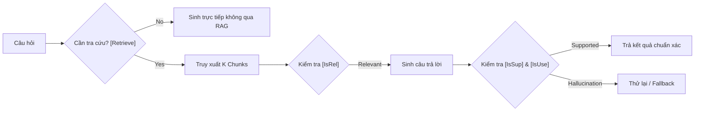

# 📚 TỔNG HỢP PAPERS KINH ĐIỂN: RAG & HỆ THỐNG TRUY XUẤT TRI THỨC

> Tuyển tập phân tích chuyên sâu các bài báo khoa học định hình nền tảng RAG (Retrieval-Augmented Generation) từ góc nhìn kỹ thuật phần mềm và kiến trúc hệ thống thực tế.

---

## 1. RAG: Retrieval-Augmented Generation for Knowledge-Intensive NLP Tasks
* **Tác giả:** Patrick Lewis et al. (Meta AI, University College London, NYU) — 2020
* **Liên kết Paper:** [arXiv:2005.11401](https://arxiv.org/abs/2005.11401)
* **Vấn đề giải quyết:** Mô hình ngôn ngữ truyền thống lưu trữ tri thức tĩnh trong trọng số tham số (parametric memory), dẫn đến lỗi thời, không trích dẫn được nguồn và dễ phát sinh ảo giác.

### ⚙️ Cơ chế kỹ thuật cốt lõi:
Kiến trúc kết hợp giữa **Dense Passage Retriever (DPR)** và **Seq2Seq Generator (BART)**:
1. Mô hình nhận truy vấn $x$, dùng bộ truy xuất dựa trên tích vô hướng vector $p_\eta(z|x) \propto \exp(\mathbf{d}(z)^T \mathbf{q}(x))$ để lấy top-$K$ tài liệu $z$.
2. Bộ sinh tính toán phân phối từ tiếp theo có điều kiện dựa trên cả $x$ và các tài liệu $z$:
   $$p_{\text{RAG-Sequence}}(y|x) = \sum_{z \in \text{top-}K} p_\eta(z|x) \prod_i p_\theta(y_i|x, z, y_{1:i-1})$$

### 💡 Bài học thực chiến cho Kỹ sư AI:
* Không cố gắng huấn luyện hay nhồi nhét tài liệu nội bộ vào trọng số của model. Hãy coi LLM là **Bộ vi xử lý suy luận (Reasoning Engine)** và Vector Database là **Ổ cứng lưu trữ (Hard Drive)**.
* Tách biệt hoàn toàn vòng đời cập nhật dữ liệu khỏi vòng đời triển khai mô hình.

---

## 2. Self-RAG: Learning to Retrieve, Generate, and Critique through Self-Reflection
* **Tác giả:** Akari Asai et al. (University of Washington, Allen Institute for AI) — 2023
* **Liên kết Paper:** [arXiv:2310.11511](https://arxiv.org/abs/2310.11511)
* **Vấn đề giải quyết:** RAG thông thường truy xuất thụ động và mù quáng ngay cả khi câu hỏi đơn giản không cần tra cứu, hoặc vẫn cố sinh câu trả lời khi tài liệu lấy về hoàn toàn không liên quan.

### ⚙️ Cơ chế Reflection Tokens (Tokens Tự Phản Biện):
Mô hình được huấn luyện để tự sinh ra 4 nhóm token đánh giá đặc biệt:
* `[Retrieve]`: Quyết định có cần gọi Vector DB không (`yes` / `no` / `continue`).
* `[IsRel]`: Đánh giá đoạn văn bản truy xuất được có liên quan tới truy vấn hay không (`relevant` / `irrelevant`).
* `[IsSup]`: Đánh giá câu trả lời vừa sinh có được ngữ cảnh bảo chứng hay không (`fully supported` / `partially supported` / `no support`).
* `[IsUse]`: Chấm điểm mức độ hữu ích tổng thể của câu trả lời (`5` đến `1`).

### 💡 Bài học thực chiến cho Kỹ sư AI:
* Khi xây dựng RAG Agent, hãy thiết lập **Router phân luồng**: Câu chào hỏi hoặc câu hỏi lập trình thuần túy không cần tốn chi phí gọi Vector DB.
* Bắt buộc phải có bước kiểm định tự động (Groundedness Check) giữa câu trả lời và context trước khi stream về cho người dùng.

---

## 3. Corrective Retrieval Augmented Generation (CRAG)
* **Tác giả:** Shi-Qi Yan et al. — 2024
* **Liên kết Paper:** [arXiv:2401.15884](https://arxiv.org/abs/2401.15884)
* **Vấn đề giải quyết:** Rủi ro nghiêm trọng khi Vector DB trả về thông tin rác hoặc hoàn toàn không chứa dữ liệu người dùng cần tìm, khiến LLM bị "đầu độc ngữ cảnh" (Context Poisoning).

### ⚙️ Cơ chế Trọng tài Đánh giá (Retrieval Evaluator):
Hệ thống chấm điểm độ tin cậy của tập tài liệu vừa lấy về thành 3 mức:
1. **Correct (Chính xác):** Tiến hành tinh lọc văn bản (Knowledge Refinement) qua phép phân rã và chấm điểm từng dải câu để loại bỏ nhiễu.
2. **Incorrect (Sai lệch hoàn toàn):** Loại bỏ toàn bộ tài liệu từ Vector DB, kích hoạt tìm kiếm Web Search (Google/Tavily/Bing) để lấy ngữ cảnh mới.
3. **Ambiguous (Mơ hồ):** Kết hợp cả dữ liệu Vector DB đã tinh lọc và dữ liệu tìm kiếm Web.

---

## 4. ColBERT & ColPali: Late Interaction & Vision-Powered Retrieval
* **ColBERT Paper:** Omar Khattab, Matei Zaharia (Stanford) — [arXiv:2004.12832](https://arxiv.org/abs/2004.12832)
* **ColPali Paper:** Manuel Faysse et al. — [arXiv:2407.01449](https://arxiv.org/abs/2407.01449) (2024)
* **Vấn đề giải quyết:** Biểu diễn cả đoạn văn bằng 1 vector duy nhất ($d=1536$) làm mất mát các chi tiết từ vựng hiếm; tài liệu có bảng biểu phức tạp khi dùng OCR thường bị vỡ cấu trúc hàng/cột.

### ⚙️ Cơ chế Late Interaction (MaxSim):
Thay vì nén cả văn bản thành một vector đơn lẻ:
* Câu truy vấn $Q$ tạo ra danh sách vector token: $\{E_{q_1}, E_{q_2}, \dots, E_{q_m}\}$.
* Đoạn văn bản $D$ tạo ra danh sách vector token: $\{E_{d_1}, E_{d_2}, \dots, E_{d_n}\}$.
* Điểm số liên quan là tổng độ tương đồng cực đại của từng token câu hỏi đối với các token tài liệu:
  $$\text{Score}(Q, D) = \sum_{i \in Q} \max_{j \in D} (E_{q_i} \cdot E_{d_j}^T)$$

**ColPali (Vision-Language Retrieval):**  
Sử dụng mô hình thị giác (PaliGemma) chia trang PDF thành các patch hình ảnh $(14 \times 14)$. Khi người dùng hỏi, hệ thống so khớp trực tiếp vector câu hỏi với các patch hình ảnh của trang PDF mà không cần OCR, bảo tồn nguyên vẹn bảng biểu và sơ đồ!

---

## 5. From Local to Global: A Graph RAG Approach (Microsoft Research)
* **Tác giả:** Darren Edge et al. (Microsoft Research) — 2024
* **Liên kết Paper:** [arXiv:2404.16130](https://arxiv.org/abs/2404.16130)
* **Vấn đề giải quyết:** RAG truyền thống dựa trên độ tương đồng ngữ nghĩa thất bại hoàn toàn trước câu hỏi mang tính khái quát toàn cục (Global Sensemaking) như: *"Những rủi ro chính được đề cập xuyên suốt trong toàn bộ 500 báo cáo kiểm toán là gì?"*.

### ⚙️ Kiến trúc Hierarchical Community Summaries:
1. **Trích xuất Thực thể & Quan hệ:** Dùng LLM trích xuất đồ thị (Nodes, Edges, Claims).
2. **Phân cụm cộng đồng (Leiden Clustering):** Gom cụm đồ thị theo thứ bậc (C0: chi tiết, C1: trung gian, C2: vĩ mô).
3. **Tóm tắt từng cụm (Community Summarization):** LLM tạo bản tóm tắt có cấu trúc cho từng cụm.
4. **Map-Reduce Global Search:** Khi nhận câu hỏi vĩ mô, hệ thống gửi câu hỏi song song đến tất cả bản tóm tắt cụm (Map) rồi tổng hợp câu trả lời cuối cùng (Reduce).
