# 🤖 TỔNG HỢP PAPERS & CẨM NANG KINH ĐIỂN: AGENTIC WORKFLOWS & TOOLS

> Tuyển tập phân tích các kiến trúc tác tử tự hành (Agentic AI), cơ chế gọi công cụ (Tool Calling), và cẩm nang thiết kế quy trình sản xuất thực tế.

---

## 1. ReAct: Synergizing Reasoning and Acting in Language Models
* **Tác giả:** Shunyu Yao, Jeffrey Zhao, Dian Yu et al. (Princeton University, Google Research) — ICLR 2023
* **Liên kết Paper:** [arXiv:2210.03629](https://arxiv.org/abs/2210.03629)
* **Vấn đề giải quyết:** Chỉ suy luận (Chain-of-Thought) thì model không thể tiếp cận dữ liệu động ngoài đời thực; chỉ hành động (Action-only) thì model thiếu khả năng suy nghĩ chiến lược và dễ mắc kẹt trong vòng lặp vô tận.

### ⚙️ Vòng lặp ReAct Chuẩn Mực:
Mô hình đan xen giữa hai luồng:
1. **Thought (Suy nghĩ):** LLM sinh ra lời độc thoại nội tâm (Inner Monologue) để theo dõi tiến trình, phân tích bối cảnh và lên kế hoạch bước tiếp theo.
2. **Action (Hành động):** LLM gọi một công cụ cụ thể với tham số xác định (`Search[Query]`, `Lookup[Term]`, `Finish[Answer]`).
3. **Observation (Quan sát):** Hệ thống môi trường trả về kết quả của Action, đưa ngược lại vào Context cho bước Thought tiếp theo.

```text
Thought 1: Tôi cần tìm xem năm sinh của tác giả cuốn sách này là bao nhiêu.
Action 1: Search["Cuốn sách Nhà Giả Kim tác giả"]
Observation 1: Tác giả là Paulo Coelho.
Thought 2: Bây giờ tôi cần tra năm sinh của Paulo Coelho.
Action 2: Search["Paulo Coelho năm sinh"]
Observation 2: Ông sinh ngày 24 tháng 8 năm 1947 tại Rio de Janeiro.
Thought 3: Tôi đã có đủ thông tin để trả lời.
Action 3: Finish["Paulo Coelho sinh năm 1947."]
```

### 💡 Bài học thực chiến cho Kỹ sư AI:
* Khi xây dựng Agent, **bắt buộc phải cho model một khoảng không gian để suy nghĩ (Scratchpad / Reasoning Field)** trước khi yêu cầu nó đưa ra lệnh gọi công cụ. Việc này tăng tỷ lệ gọi công cụ chính xác lên hơn 40%.

---

## 2. Reflexion: Language Agents with Verbal Reinforcement Learning
* **Tác giả:** Noah Shinn, Federico Cassano et al. (Northeastern University, MIT) — NeurIPS 2023
* **Liên kết Paper:** [arXiv:2303.11366](https://arxiv.org/abs/2303.11366)
* **Vấn đề giải quyết:** Huấn luyện tăng cường truyền thống (RL via gradient updates) tốn hàng nghìn giờ GPU và làm thay đổi trọng số mô hình. Khi Agent thực thi task thất bại (ví dụ: code bị lỗi test case), làm sao để nó tự sửa sai mà không cần train lại?

### ⚙️ Cơ chế Phản hồi bằng Ngôn ngữ (Verbal Self-Reflection):
1. **Actor:** Sinh ra chuỗi hành động và quan sát kết quả.
2. **Evaluator:** Chấm điểm kết quả thực thi (Binary Reward $0/1$ hoặc Test Passed/Failed).
3. **Self-Reflection Model:** Khi điểm số là $0$, mô hình phân tích: *"Tại sao kế hoạch trước bị thất bại? Điểm yếu ở đâu?"* và sinh ra 1 đoạn nhận xét (Self-reflection text).
4. **Episodic Memory Buffer:** Lưu trữ đoạn nhận xét này vào Context của lần thử tiếp theo (Trial $t+1$).

---

## 3. Toolformer: Language Models Can Teach Themselves to Use Tools
* **Tác giả:** Timo Schick, Jane Dwivedi-Sankey et al. (Meta AI) — 2023
* **Liên kết Paper:** [arXiv:2302.04761](https://arxiv.org/abs/2302.04761)
* **Ý nghĩa:** Chứng minh rằng mô hình ngôn ngữ có thể tự học cách chèn các token gọi API ngoại vi (Máy tính tính toán, Lịch biểu, Máy dịch thuật) vào giữa luồng văn bản mà không làm mất đi khả năng sinh ngôn ngữ tự nhiên.
* Đây là tiền đề cho tính năng **Native Function Calling / Tool Calling** của OpenAI, Gemini và Anthropic ngày nay.

---

## 4. Cẩm Nang Kỹ Nghệ: Building Effective Agents (Anthropic, Dec 2024)
* **Tác giả:** Erik Schluntz & Barry Zhang (Anthropic)
* **Tài liệu gốc:** [Anthropic Engineering Research](https://www.anthropic.com/research/building-effective-agents)

### 📌 5 Mẫu Thiết Kế Quy Trình (Workflow Patterns) Cốt Lõi:

```mermaid
flowchart TD
    subgraph 1. Prompt Chaining
        A1["Bước 1: Trích xuất"] --> A2["Bước 2: Dịch thuật"] --> A3["Bước 3: Định dạng"]
    end

    subgraph 2. Routing
        R1["Input"] --> R2{"Bộ định tuyến (Router)"}
        R2 --> R_Sales["Prompt Bán hàng"]
        R2 --> R_Tech["Prompt Kỹ thuật"]
    end

    subgraph 3. Parallelization
        P1["Input"] --> P_A["Kiểm tra Pháp lý"]
        P1 --> P_B["Kiểm tra Tài chính"]
        P_A --> P_Merge["Tổng hợp kết quả"]
        P_B --> P_Merge
    end

    subgraph 4. Orchestrator-Workers
        O1["Orchestrator (Phân rã task)"] --> W1["Worker 1"]
        O1 --> W2["Worker 2"]
        W1 --> O1
        W2 --> O1
    end

    subgraph 5. Evaluator-Optimizer Loop
        E1["Generator (Viết Code)"] --> E2["Evaluator (Chạy Unit Tests)"]
        E2 -- "Failed" --> E1
        E2 -- "Passed" --> E_Done["Hoàn thành"]
    end
```



### 💡 Triết lý thiết kế tối thượng của Anthropic:
> *"Khi xây dựng ứng dụng với LLM, hãy tìm kiếm giải pháp đơn giản nhất có thể trước tiên. Đừng nhảy ngay vào xây dựng hệ thống đa tác tử (Multi-agent) phức tạp nếu một chuỗi Prompt Chaining hoặc Routing đơn giản đã giải quyết tốt bài toán."*
