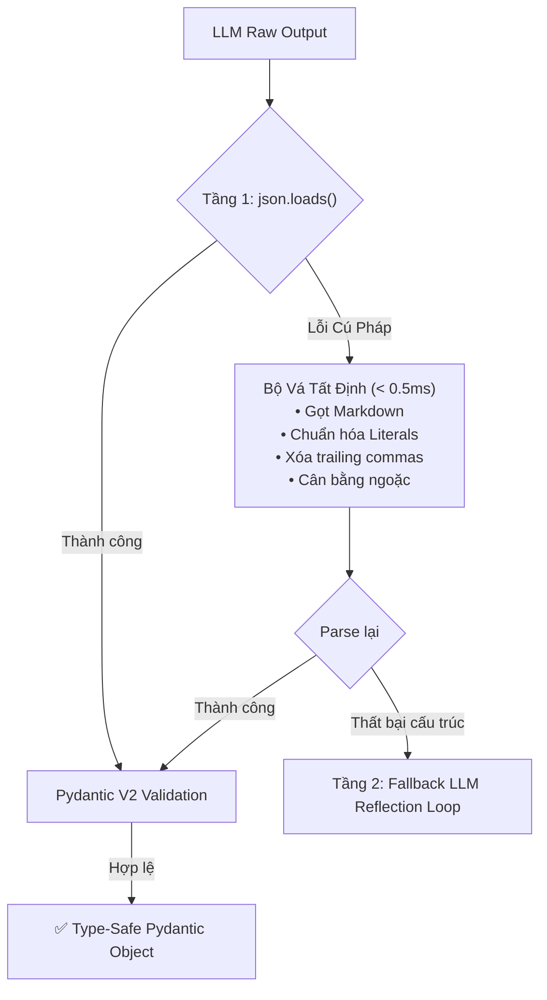

# 🧩 MẪU THIẾT KẾ 01: STRUCTURED OUTPUTS & SELF-HEALING JSON

> **Mục tiêu:** Đảm bảo 100% dữ liệu trả về từ LLM tuân thủ chặt chẽ định dạng JSON Schema mong muốn của backend microservices, xử lý triệt để tình trạng vỡ cú pháp mà không lãng phí chi phí token gọi lại model.

---

## 1. Bài Toán Thực Tế (The Problem)

Khi tích hợp LLM vào luồng tự động hóa backend (FastAPI, Golang, Spring Boot), mô hình ngôn ngữ lớn bản chất là bộ sinh từ xác suất (probabilistic token generator). Điều này dẫn tới các lỗi kinh điển:
1. Bao bọc markdown fences (````json ... ````) kèm câu chào hỏi đàm thoại thừa.
2. Sinh Python literals như `True`, `False`, `None` thay vì chuẩn JSON `true`, `false`, `null`.
3. Để lại dấu phẩy thừa (trailing commas) trước ngoặc đóng `}` hoặc `]`.
4. Bị đứt nửa chừng khi chạm context limit, thiếu ngoặc đóng.

Nếu mỗi lần lỗi đều gửi prompt bắt LLM sinh lại:
* Tốn thêm **1,500 - 3,000ms latency**.
* Tốn thêm **100% chi phí token**.

---

## 2. Kiến Trúc 2 Tầng Xử Lý (Two-Tier Architecture)



---

## 3. Cách Sử Dụng Nhanh

```python
from schema import InvoiceExtraction
from healer import SelfHealingJSONParser

raw_llm_output = '```json { "invoice_number": "INV-01", "items": [], "grand_total": 100.0, } ```'

# Tự động gọt sạch và parse trong 0.2ms
invoice, duration_ms, was_healed = SelfHealingJSONParser.parse(raw_llm_output, InvoiceExtraction)

print(f"Hóa đơn: {invoice.invoice_number} | Thời gian vá: {duration_ms:.2f}ms | Đã vá: {was_healed}")
```
