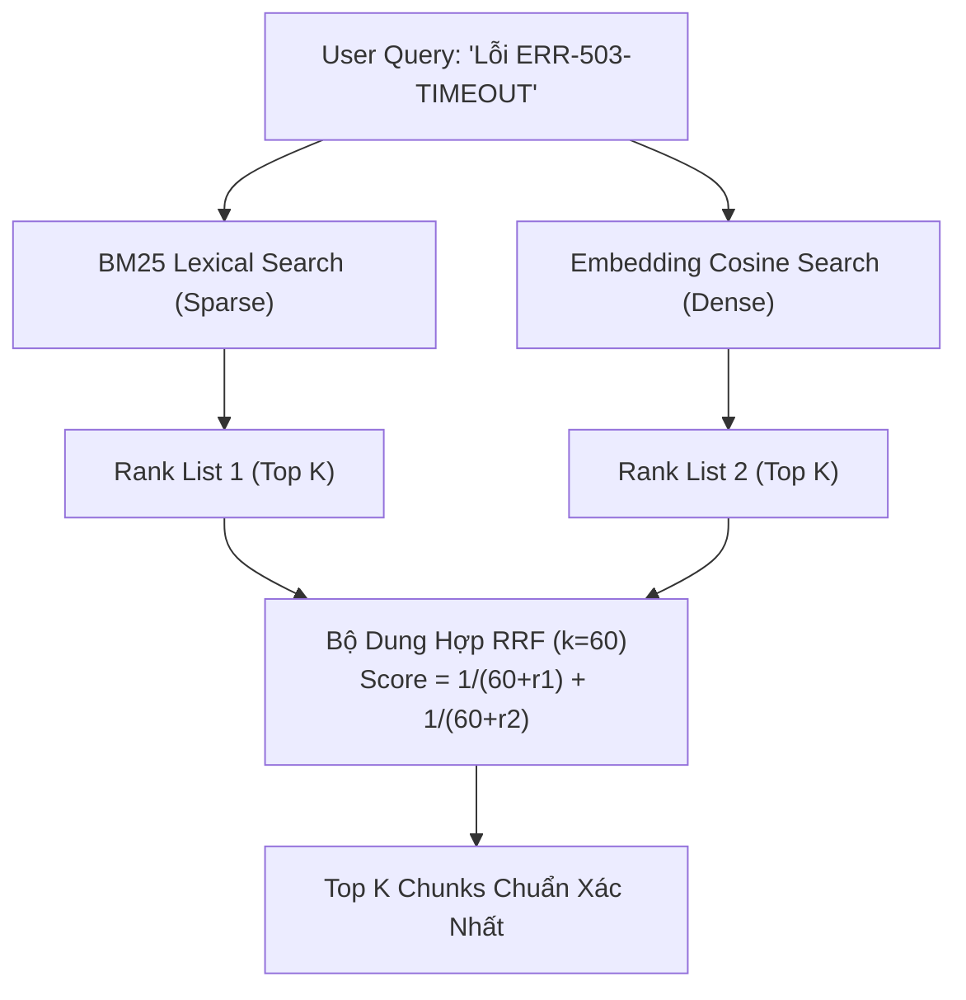

# 🔍 MẪU THIẾT KẾ 02: HYBRID SEARCH & RECIPROCAL RANK FUSION (RRF)

> **Mục tiêu:** Kết hợp sức mạnh tìm kiếm từ khóa chính xác (Sparse Lexical Search) với tìm kiếm ngữ nghĩa đa chiều (Dense Vector Search) để tối đa hóa Recall và Precision trong hệ thống RAG doanh nghiệp.

---

## 1. Điểm Yếu Của Dense Vector Search Đơn Thuần

Nhiều hệ sinh thái RAG chỉ dựa vào `text-embedding-3-small` hoặc mô hình vector tương đương. Khi gặp:
1. **Mã lỗi phần mềm**: `ERR-503-TIMEOUT`, `HTTP-403`, `NullPointerException`.
2. **Số seri / Mã sản phẩm**: `SKU-9921-X`, `IP-192.168.1.1`.
3. **Từ viết tắt chuyên ngành**: BHYT, BHXH, VAT, EBIT.

Mô hình Dense Embeddings thường nén ngữ nghĩa và làm mờ các token đặc thù này, khiến câu trả lời bị sai lệch nghiêm trọng.

---

## 2. Công Thức Dung Hợp Reciprocal Rank Fusion (RRF)

RRF là thuật toán xếp hạng độc lập với thang điểm gốc (không bị ảnh hưởng bởi độ lệch phân phối điểm cosine so với điểm BM25):

$$RRF(d) = \sum_{m \in M} \frac{1}{k + rank_m(d)}$$

* $M$: Tập hợp các bộ truy xuất (ở đây là BM25 và Vector Search).
* $rank_m(d)$: Thứ hạng của tài liệu $d$ trong bộ truy xuất $m$ (1-indexed).
* $k$: Hằng số làm mượt (Smoothing constant), giá trị chuẩn theo công bố của Cormack et al. là **$k = 60$**.



---

## 3. Cách Sử Dụng Nhanh

```python
from retriever import HybridRetriever

docs = [
    "Lỗi ERR-404: Không tìm thấy.",
    "Lỗi ERR-503-TIMEOUT: Cụm Inference quá tải.",
    "Chính sách bảo mật thẻ tín dụng."
]

retriever = HybridRetriever(docs, rrf_k=60)
results = retriever.search_hybrid_rrf("máy chủ bị ERR-503-TIMEOUT", top_k=2)

for item in results:
    print(f"Rank Score: {item['rrf_score']:.5f} | Nội dung: {item['content']}")
```
