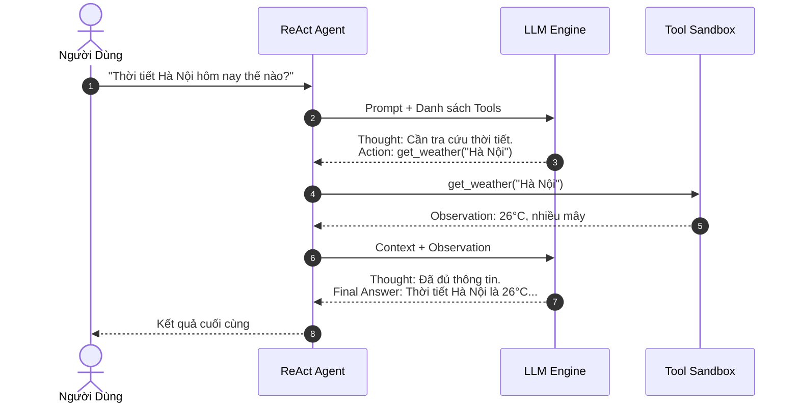

# 🤖 MẪU THIẾT KẾ 03: AGENTIC REACT & DYNAMIC ROUTING

> **Mục tiêu:** Trao quyền cho LLM tự động suy luận, lập kế hoạch và chủ động gọi các công cụ ngoại vi (APIs, Database, Shell, Search) theo vòng lặp chuẩn ReAct (Thought -> Action -> Observation).

---

## 1. Bản Chất Chu Trình ReAct (ICLR 2023)

Mô hình LLM thông thường chỉ có thể sinh text hoặc dự đoán từ tiếp theo. Khi tích hợp công cụ, nếu bắt model gọi trực tiếp mà không cho không gian suy nghĩ, tỷ lệ lỗi tham số và gọi nhầm tool lên đến **35 - 50%**.

Cơ chế ReAct giải quyết triệt để vấn đề này qua 3 bước:
1. **Thought (Suy nghĩ):** LLM độc thoại nội tâm (Reasoning Scratchpad) phân tích bối cảnh và xác định xem còn thiếu dữ liệu gì.
2. **Action (Hành động):** LLM phát ra lệnh gọi công cụ có cấu trúc với tham số rõ ràng.
3. **Observation (Quan sát):** Môi trường thực thi trả kết quả về bối cảnh prompt cho bước Thought tiếp theo.



---

## 2. Cách Sử Dụng Nhanh

```python
from agent import ToolRegistry, ReActAgent

registry = ToolRegistry()
registry.register("get_weather", "Tra cứu thời tiết", lambda location: f"26°C tại {location}")

agent = ReActAgent(registry=registry)
res = agent.run("Thời tiết Hà Nội hôm nay ra sao?")
print("Kết quả:", res["final_answer"])
```
