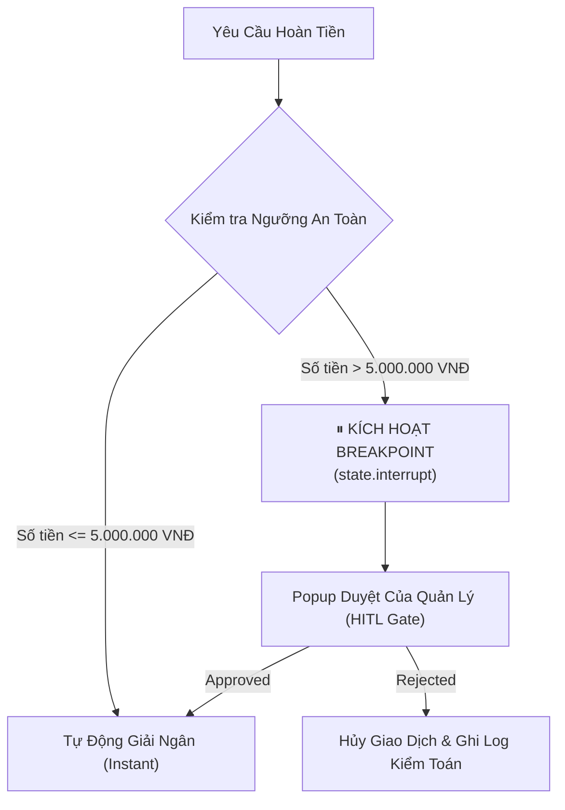

# 🛡️ MẪU THIẾT KẾ 04: HUMAN-IN-THE-LOOP & BREAKPOINTS

> **Mục tiêu:** Thiết lập các cổng ngắt an toàn (Interrupt Breakpoints) trong các tác tử tự hành để yêu cầu con người phê duyệt trước khi thực thi các hành động rủi ro cao (thanh toán tiền, xóa dữ liệu, gửi email đại chúng).

---

## 1. Rủi Ro Của Hệ Thống Hoàn Toàn Tự Động (Full Autonomy)

Trong các hệ thống AI cấp doanh nghiệp, trao 100% quyền tự quyết cho LLM tiềm ẩn nguy cơ thảm họa tài chính và pháp lý:
* AI bị lừa bởi Prompt Injection cấp quyền chuyển tiền.
* AI ảo giác đưa ra mức bồi thường vượt quy định.
* AI tự ý sửa đổi cơ sở dữ liệu sản xuất.

**Giải pháp công nghiệp:** Kiến trúc **Cổng Phân Tầng Theo Rủi Ro (Risk-tiered Gateways)**:
* Các giao dịch nhỏ dưới ngưỡng định mức ($\le 5.000.000\text{ VNĐ}$): Tự động thông qua để đảm bảo tốc độ và trải nghiệm người dùng.
* Các giao dịch lớn ($> 5.000.000\text{ VNĐ}$): Kích hoạt `state.interrupt()`, đóng băng tiến trình và chờ tín hiệu phê duyệt tường minh từ Quản lý.



---

## 2. Cách Sử Dụng Nhanh

```python
from hitl_gate import HITLApprovalGateway

gateway = HITLApprovalGateway(auto_approve_threshold=5_000_000.0)

# Giao dịch lớn sẽ tự động chuyển trạng thái sang WAITING_APPROVAL
tx = gateway.submit_transaction(
    user_id="USR-01",
    amount=25_000_000.0,
    description="Hoàn tiền hợp đồng VIP"
)
print("Trạng thái giao dịch:", tx.status)  # WAITING_APPROVAL

# Sau khi Quản lý duyệt:
approved_tx = gateway.review_ticket(tx.transaction_id, decision=True, approver_name="Lead_Manager")
print("Trạng thái sau duyệt:", approved_tx.status)  # DISBURSED
```
