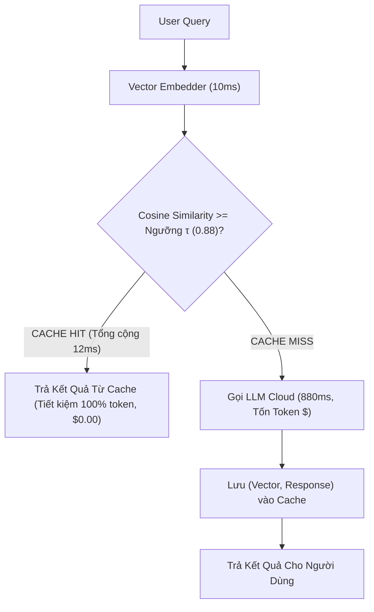

# ⚡ MẪU THIẾT KẾ 05: SEMANTIC CACHING & FINOPS LATENCY WATERFALL

> **Mục tiêu:** Lưu trữ và tái sử dụng kết quả suy luận của LLM dựa trên khoảng cách ngữ nghĩa (Vector Cosine Similarity), cắt giảm độ trễ từ 880ms xuống dưới 15ms và tiết kiệm tới 98% chi phí API.

---

## 1. Giới Hạn Của Exact String Cache Truyền Thống

Trong web thông thường, caching dựa vào Exact Match (Key-Value trên Memcached hoặc Redis):
* User A hỏi: *"Làm sao để đổi mật khẩu?"*
* User B hỏi: *"Hướng dẫn thay pass tài khoản"*

Dù cùng một mục đích câu hỏi, Exact Cache sẽ trả về **Cache Miss** và buộc hệ thống gọi lại LLM Cloud tốn $0.005 và chờ 850ms.

---

## 2. Kiến Trúc Semantic Cache & Thác Nước Độ Trễ (Latency Waterfall)



### So sánh Hiệu Năng Thực Tế:
* **LLM Cloud Roundtrip:** ~880 ms | Chi phí: $0.005 / request
* **Vector Semantic Cache Hit:** ~12 ms | Chi phí: $0.000 / request
* **Gia tốc:** **Nhanh hơn 98.6%**, chi phí giảm gần như triệt để với các câu hỏi thường gặp (FAQ, Customer Support).

---

## 3. Cách Sử Dụng Nhanh

```python
from semantic_cache import SemanticCacheManager

cache = SemanticCacheManager(similarity_threshold=0.88)

# Nạp câu hỏi mẫu vào cache
cache.put("Làm sao để đổi mật khẩu?", "Vào Cài đặt -> Bảo mật -> Đổi mật khẩu.")

# Tra cứu với câu hỏi có ngữ nghĩa tương đồng
ans, latency_ms, is_hit = cache.query("Làm sao để đổi mật khẩu?", model="gpt-4o")

print(f"Hit: {is_hit} | Độ trễ: {latency_ms:.2f}ms | Phản hồi: {ans}")
print(cache.get_finops_report())
```
